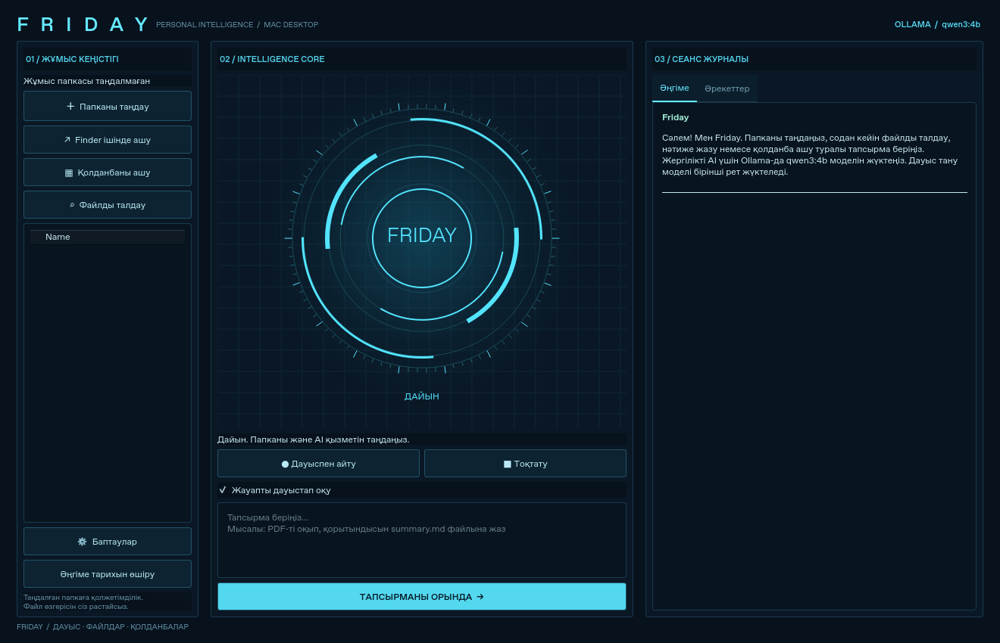

# Friday Desktop — personal Mac AI assistant

Friday now opens as a **native Qt desktop window**, with no Safari, Chrome or web server. It combines a tool-calling AI agent, a user-selected working folder, native microphone recording and Mac speech output. M1 is supported by the dependency wheels; physical Mac hardware testing is still required.



Интерфейс JARVIS стиліндегі көгілдір HUD: анимацияланған реактор, жұмыс папкасы,
әңгіме және әрекеттер журналы. Реактор тыңдау, тапсырманы орындау, дыбыстау және
қате күйлерін көрсетеді. Анимация микрофон дыбысының деңгейін өлшемейді.

`libportaudio.dylib Not Opened` шықса, осы жаңартылған нұсқаны бөлек папкаға
шығарып, `start.command` арқылы іске қосыңыз. Іске қосқыш кітапханаларды ескі
репозиторий папкасынан іздетпейді. Gatekeeper қорғанысын өшірмеңіз. Егер ескерту
қайталанса, бұғатталған кітапхананың толық жолы қажет; Mac-тағы бұл түзету
Linux-тағы GUI тексерулерінен бөлек тексерілуі тиіс.

Screenshot: the Qt GUI rendered in the Linux cloud; not a physical Mac capture.

## Start on your M1 MacBook

Requirements: **macOS 12 Monterey or newer** and **Python 3.10–3.13**. Python 3.12 is recommended: [official universal2 installer](https://www.python.org/downloads/release/python-31210/). PySide6 6.8 does not support Python 3.14.

1. Install and open [Ollama](https://ollama.com/download/mac) for local AI without an API key.
2. Download **Code → Download ZIP**, extract it and open Terminal in the new folder.
3. Run:

```bash
bash start.command
```

The launcher creates `.venv-desktop`, installs desktop dependencies, prepares `qwen3:4b` when Ollama is available and opens the desktop GUI. The first model/dependency downloads can take time and several GB. If Ollama is unavailable, the GUI still opens; select OpenAI in settings or install Ollama. Use `FRIDAY_SKIP_OLLAMA=1 bash start.command` to skip the launcher model preparation.

The isolated Python entry point prevents the repository's old Python 3.14/macOS dependency artifacts from shadowing installed packages. The original `.venv` used by the web app is preserved.

## What it can do

- Open a chosen folder in Finder and open an installed Mac app by its catalog name.
- List/search files inside the folder you approved.
- Read UTF-8 text, code, CSV/JSON, the first 20 PDF pages and DOCX text.
- Use file contents to answer questions, summarize or prepare a requested deliverable.
- Propose creating/editing text or code files, show the exact diff, and save only after you approve.
- Show the real tool execution log, keep local chat history and accept microphone input.

Example requests after choosing a working folder:

> «Папкадағы report.pdf файлын оқып, негізгі ойларын summary.md файлына жаз.»
>
> «main.py файлын талдап, қателерін түсіндір. Әзірше өзгертпе.»
>
> «Calculator қолданбасын аш.»
>
> «notes деген файлдарды тауып, тізімін көрсет.»

The model selects tools; the application executes validated functions, never model-generated shell commands. The file scope is the selected folder. Path traversal, symlink escapes and known credential paths are rejected. Writes use an atomic replacement and verify the original file has not changed since review. An approval cancellation does not write anything. Stopping a task prevents further actions but does not undo actions already completed.

Application opening launches the app; it **does not control its internal UI**. This version does not delete files, execute arbitrary code, install software, send mail or autonomously press buttons in other apps. Scanned PDFs need OCR; XLSX/images/audio documents are not analyzed by the file reader. Large files and long tasks have explicit limits. Local model quality determines how well the assistant understands complex requests; it is not the fictional JARVIS.

## Voice and privacy

Press **Дауыспен айту**, speak, then press again to stop recording and send the recognized text. Recording is limited to 60 seconds. This is explicit recording, not an always-on background listener. Select Kazakh, Russian or English in settings. Allow microphone access in macOS **Privacy & Security → Microphone** for Terminal/Python or the packaged Friday app as requested by the OS.

- Local Ollama mode uses **faster-whisper small on CPU/int8**. Its model downloads from Hugging Face on first voice use and is then cached. Audio is transcribed locally. It uses PyAV, so a separate FFmpeg install is not required for the desktop app.
- OpenAI mode uses `whisper-1` transcription and OpenAI chat tool calls; the audio and selected file excerpts are sent to OpenAI. It requires a valid API key and quota.
- API keys entered in settings are held in memory for that session, never saved in preferences/history. Existing `FRIDAY_API_KEY`, `Nurzhik_06` or `OPENAI_API_KEY` bindings are supported.
- Speech output uses the native Mac `say` command, with no browser synthesis. When a Kazakh voice is unavailable, it reports using a Russian/English system voice; pronunciation can be imperfect. Uncheck spoken answers for text-only use.

Settings/history: `~/Library/Application Support/Friday/workspace.json` (private file permissions). Local speech model cache: `~/Library/Caches/Friday/whisper`. File excerpts are not automatically indexed across your entire Mac. Documents are treated as untrusted input, not instructions to grant new access.

## Build a clickable Friday.app on your Mac

After `start.command` has prepared dependencies, close the GUI and run:

```bash
bash make-mac-app.command
```

PyInstaller builds `dist/Friday.app` for the architecture of the Python interpreter on that Mac. Open it in Finder and optionally copy it to Applications. The bundle includes microphone usage metadata and stages only application source, excluding the repository's stale vendored executables/native binaries. AI/Whisper model downloads remain external caches and are not embedded into the app.

This repository includes the build instructions, **not a prebuilt/signed/notarized macOS release**. The .app build must run on macOS; an actual M1 bundle could not be built or tested in the Linux cloud machine.

## Development and checks

```bash
python3 -m venv .venv-desktop
source .venv-desktop/bin/activate
python -m pip install -r requirements-desktop.txt
python -I run_tests.py
python -I desktop_entry.py
```

GUI tests use Qt's offscreen platform. The desktop tests exercise actual file reads/writes, approval acceptance/denial, concurrent file changes, path/secret/symlink rejection, the tool protocol over a real local HTTP fixture, native GUI worker/approval flow, WAV recording structure and private settings persistence. Models, microphone hardware and native Mac launches are fixtures in these tests.

Current-instance verification: the native Qt window opened in Linux, and the GUI agent workflow produced a real summary file after approval. No OpenAI key or Ollama model was available for real inference. Hugging Face model access in the cloud returned proxy 403, so real Whisper inference was not validated there. Actual Mac microphone privacy, playback, app launches and .app packaging still need an M1 device check. Do not describe those as tested merely because the fixture tests pass.

Official implementation references: [Qt for Python](https://doc.qt.io/qtforpython-6/), [Ollama tool calling](https://docs.ollama.com/capabilities/tool-calling), [OpenAI function calling](https://platform.openai.com/docs/guides/function-calling), [faster-whisper](https://github.com/SYSTRAN/faster-whisper), [PyInstaller macOS bundles](https://pyinstaller.org/en/stable/usage.html#building-macos-app-bundles). PyPI metadata confirmed the chosen Qt wheel is `macosx_12_0_universal2` and supports Python <3.14.

## Optional legacy web/voice interfaces

`bash web.command` starts the previous web UI. Browser smoke tests are in `tests/browser-smoke.cjs`, `tests/voice-smoke.cjs` and `tests/native-speech-smoke.cjs`, requiring Playwright and an installed Chromium browser. `requirements-web.txt` is enough for web-only runtime; the complete Python test suite now needs desktop dependencies.

The original `main.py` voice loop uses `requirements.txt`, OpenAI Whisper, platform audio libraries and a physical microphone. It is retained for compatibility. The committed old macOS Python binaries are not used by the new desktop launcher or app bundle.
